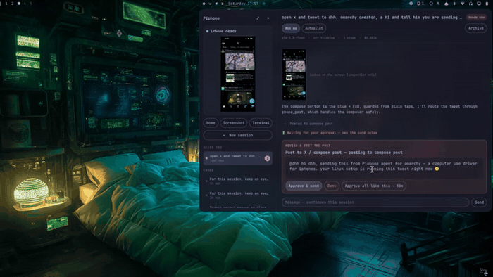

# Piphone

**Hand your iPhone a mandate and let an agent run it for you — over USB, through WebDriverAgent, as an [Omarchy](https://omarchy.org) shell plugin.**

[](https://omarchy.org)
[](LICENSE)
[](go/iphone-wdad)
[](pi-extension)
[](#requirements)
[](https://github.com/areu01or00/Piphone-plugin-for-Omarchy/issues)

<p align="center">
  
</p>

---

You plug your iPhone into a Wayland/Hyprland machine, open the bar widget, and give it a session-based
task in plain language ("watch this X topic and summarise it to me", "find jobs matching my CV and draft
outreach"). An agent drives the phone through the accessibility tree — reading labelled elements and
acting on them — never through blind screen coordinates. Sessions keep running when the panel is closed,
can be followed up, stopped, and reviewed.

## Features

- **Bar widget + panel.** Status-reflecting icon in the Omarchy bar; click for a floating/full panel to
  compose tasks and follow sessions live.
- **Accessibility-first control.** Every action targets a labelled element; a screenshot tool exists for
  inspection only. No coordinate tapping.
- **Guarded posting.** Send/Post/Follow actions go through a guard with ask/autopilot modes and per-hour /
  per-session limits, so an autonomous run can't spam.
- **App-scoped sessions.** Grant a session only the apps it needs; per-app playbooks nudge the agent.
- **Rootless, loopback-only.** WebDriverAgent runs over a userspace usbmux tunnel; WDA HTTP is exposed
  only on `127.0.0.1`. No jailbreak, no root, no TUN device.
- **Live view.** Optional MJPEG mirror of the phone while a session runs.

## How it works

```
Omarchy bar widget / panel   (omarchy-plugin/*.qml)
        │  spawns, one per session
        ▼
Pi agent  ──  phone.ts tools  (pi-extension/)   ──►  wda.sock (owner-only, 0600)
                                                          ▲
iphone-wdad  (go/iphone-wdad) ── userspace tunnel ────────┘
   watches usbmux, runs WebDriverAgent over testmanagerd,
   serves WDA + MJPEG over Unix sockets in $XDG_RUNTIME_DIR/iphone-agent/,
   runs with PrivateNetwork=yes so the tunnel isn't exposed to other users
        ▲
   USB ─┘  iPhone running a signed WebDriverAgent
```

- **`go/iphone-wdad`** — the WDA supervisor (one static Go binary). See [its README](go/iphone-wdad/README.md).
- **`pi-extension/phone.ts`** — the agent's phone toolset: app-bound screen reads, ref-based actions,
  guarded post, screenshot, and a watcher that sleeps between events.
- **`omarchy-plugin/`** — the Quickshell plugin: `Service.qml` owns sessions, `IPhoneAgent.qml` is the
  panel, `BarWidget.qml` the bar icon.
- **`c/`** — a libc-only diagnostic CLI (`phone`) and an MJPEG frame tap.
- **`wda/`** — WebDriverAgent signing: `resign.sh` renews the free provisioning profile each week.

## Requirements

- **Omarchy** (Arch + Hyprland + the Omarchy shell).
- An **iPhone** with **WebDriverAgent signed and installed** (a free Apple ID works; the profile expires
  every 7 days — see [`wda/README.md`](wda/README.md)), paired to this machine over USB.
- **[Pi](https://github.com/earendil-works/pi)** on `PATH` (or set `PI_BIN`), with a model configured —
  default is `openrouter/deepseek/deepseek-v4.1-flash`, so an **OpenRouter API key** in your environment.
- **Go 1.26+** and a **C toolchain** to build the supervisor and the `c/` tools (`install.sh` does this).
- `pymobiledevice3` only when you re-sign WebDriverAgent with `wda/resign.sh`.

## Install

```bash
# 1. Install the plugin (clones this repo into ~/.config/omarchy/plugins/)
omarchy plugin add https://github.com/areu01or00/Piphone-plugin-for-Omarchy.git --enable

# 2. Build + wire up the backend (Go supervisor, C tools, systemd user service)
cd ~/.config/omarchy/plugins/areu01or00.piphone
./install.sh

# 3. Point the supervisor at your signed WDA runner (ends in your Apple Team ID).
#    Use a systemd drop-in so the user service picks it up (a shell export won't reach it):
mkdir -p ~/.config/systemd/user/iphone-wdad.service.d
printf '[Service]\nEnvironment=IPHONE_WDA_RUNNER=com.facebook.WebDriverAgentRunner.xctrunner.<YOUR_TEAM_ID>\n' \
  > ~/.config/systemd/user/iphone-wdad.service.d/runner.conf
systemctl --user daemon-reload && systemctl --user restart iphone-wdad.service
```

`install.sh` is idempotent: it checks dependencies, builds the static Go supervisor and the C tools,
creates the runtime data dir, and links + enables the `iphone-wdad` user service. The one thing it can't
do for you is sign WebDriverAgent on the phone — see [`wda/README.md`](wda/README.md) (a free Apple ID
works; the profile expires every 7 days, renew with `wda/resign.sh`).

Then plug in your iPhone and click the **Piphone** icon in the bar. If the daemon is healthy the panel
shows the phone as ready; otherwise it shows `no_phone` / an error with a message.

### Environment variables

| Variable | Purpose | Default |
|---|---|---|
| `IPHONE_WDA_RUNNER` | WDA runner bundle id (xctrunner + your Team ID) | placeholder — **must set** |
| `PI_BIN` | path to the `pi` binary | mise install path, else `pi` on `PATH` |
| `IPHONE_AGENT_REPO` | override the plugin/code location (dev checkouts) | the installed plugin dir |
| `IPHONE_AGENT_PROVISION` | path to your `.mobileprovision` | `~/.local/share/iphone-agent/wda.mobileprovision` |

## Safety & privacy

- Actions that post, send, follow, or message are gated: **ask** mode requires approval; **autopilot**
  respects per-hour and per-session caps.
- The agent only sees apps you scope into a session.
- **Owner-only control plane.** WebDriverAgent and the MJPEG live view are served only over Unix sockets
  (`wda.sock` / `mjpeg.sock`, `0600`, in the `0700` `$XDG_RUNTIME_DIR/iphone-agent`), never a loopback TCP
  port. The supervisor runs with `PrivateNetwork=yes`, so the go-ios userspace tunnel's internal localhost
  listener is isolated in its own network namespace and unreachable by other local users.
- Private memory (`profile.md`) is written via stdin (never argv) and kept `0600` in a `0700` dir.
- The WDA daemon logs to stderr and **never logs screen content**; state files are written `0600`.
- Nothing leaves your machine except the model API calls you configure.

## Development

```bash
# Pi phone-tool unit tests
node --experimental-strip-types --test test/phone.test.ts

# Supervisor build + vet
( cd go/iphone-wdad && go build ./... && go vet ./... )

# Shell + validate the plugin manifest
bash -n wda/resign.sh bin/iphone-agent install.sh
omarchy plugin validate .
```

> Two tests (`type`/keyboard round-trips) require a live WDA endpoint and are expected to fail without a
> phone attached; the rest run offline.

## License

MIT — see [LICENSE](LICENSE).
